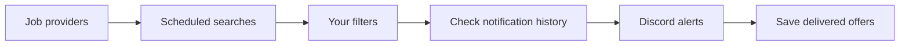

<div align="center">

# job-pulse

**Your next opportunity, straight to your notifications.**

Monitor job sources, filter offers by your criteria, and receive new matches in Discord.
Self-hosted · Configured with YAML · Built with TypeScript

[](LICENSE)
[](package.json)
[](#quick-start-with-docker)

[Quick start](#quick-start-with-docker) · [Providers](#job-providers) · [Connectors](#notification-connectors) · [Configuration](#make-it-your-own) · [Roadmap](#roadmap)

</div>

## What does it do?

Job Pulse runs scheduled searches across job platforms, keeps offers that match your preferences, and sends notifications for matches it has not already delivered. Use it to follow freelance missions, permanent roles, or several searches with different criteria and Discord channels.

For example: watch for TypeScript freelance work, filter by daily rate and remote policy, and receive a message with the job title, location, rate, remote status, source and original listing link.



It runs as a background worker on your machine or server. Configuration lives in a YAML file, credentials in environment variables, and notification history in a local JSON file. There is no web dashboard or database server to set up.

## Features

- **Multiple watches** — separate criteria and Discord destinations for each search.
- **Multiple sources** — select one provider or combine several within a watch.
- **Precise filtering** — keywords, required technology groups, title constraints, exclusions, contracts, locations, remote policy and minimum daily rate.
- **Persistent history** — remember delivered offers across restarts, per watch and provider.
- **Controlled notifications** — batch messages, limit notifications per run and opt into `@here` only when wanted.
- **Configurable scheduling** — cron expressions and time zones, plus a one-shot mode.
- **Self-hosted deployment** — Docker Compose, a non-root container, runtime secrets and a persistent data volume.
- **Failure handling** — request timeouts, bounded retries, structured logs and continued searches when one source fails.

## Job providers

Providers are the **sources Job Pulse searches**. “Available” means the adapter is implemented; platform access and compatibility must still be confirmed for your use.

| Provider | Status | How it works | Setup / access |
| --- | --- | --- | --- |
| **Free-Work** | ✅ Available | Parses search pages and job metadata | `provider: free-work`; no API key used by the adapter |
| **Pylote** | ✅ Available | Searches through an authenticated endpoint | `provider: pylote`; requires `PYLOTE_API_KEY` and appropriate access |
| **Collective** | ⚠️ Available — restricted use | Queries public-page GraphQL search via `curl` | `provider: collective`; separate authorization required; excluded from the default config |
| **RSS / Atom job feeds** | 🔜 Soon | Planned support for job feeds | Not implemented |
| **Greenhouse job boards** | 🔜 Soon | Planned company job-board integration | Not implemented; access review pending |
| **Lever job boards** | 🔜 Soon | Planned company job-board integration | Not implemented; access review pending |

> **Provider access:** this is an independent project, not an official integration with these platforms. Collective's terms explicitly prohibit automated use without separate authorization. For all sources, check the [provider notes and access conditions](docs/providers.md) before enabling live searches. Publicly reachable data is not automatically licensed for collection or redistribution.

## Notification connectors

Connectors are **where matching offers are sent**. Discord is the only connector implemented today.

| Connector | Status | Delivery |
| --- | --- | --- |
| **Discord** | ✅ Available | Webhook messages with job links, location, daily rate, remote status and source |
| **Slack** | 🔜 Soon | Planned channel notifications |
| **Telegram** | 🔜 Soon | Planned bot notifications |
| **Email / SMTP** | 🔜 Soon | Planned email notifications |
| **Generic webhook** | 🔜 Soon | Planned HTTP delivery to your own tools and automations |

**Soon** marks planned work, not a feature you can enable today. No release dates are committed. See the [roadmap](#roadmap).

## Quick start with Docker

**You need:** Git, Docker with Compose, and a Discord webhook for the channel that should receive alerts.

### 1. Get the project

```sh
git clone https://github.com/ayoub9360/job-watcher-community.git job-pulse
cd job-pulse
cp config/config.example.yaml config/config.yaml
cp .env.example .env
```

### 2. Set your destination and search

Put your Discord webhook URL in `DISCORD_WEBHOOK_URL` inside `.env`. Edit `config/config.yaml` to choose your search terms and criteria. Both files are ignored by Git.

The supplied example searches for **TypeScript freelance jobs on Free-Work every 30 minutes**, with one page per query and a global limit of ten notifications per run. It does not impose a minimum daily rate or a remote policy.

### 3. Validate and start

```sh
docker compose build

# Check the configuration offline; no searches or notifications.
docker compose run --rm job-pulse node dist/validate-config.js

# Start the scheduled worker.
docker compose up -d
docker compose logs -f job-pulse
```

The worker waits for the next scheduled tick. To run an immediate search instead, use this command **before starting the scheduled worker**, or stop it first:

```sh
docker compose run --rm job-pulse node dist/main.js --once
```

A live run can send notifications for existing matches on the first check. Keep one worker per state file.

### Updates and persistence

- After editing configuration or `.env`: `docker compose up -d --force-recreate`.
- After changing code or dependencies: `docker compose up -d --build`.
- To stop: `docker compose down`. The named data volume is preserved.

Configuration is mounted read-only and credentials are injected at runtime. Neither is baked into the image. The container runs as UID 1000; a custom bind mount for data must be writable by that user. Removing or replacing the data volume loses notification history and can resend offers. Keep the same data volume when changing Compose project names or migrating an installation.

## Make it your own

Each entry under `watchers` defines a search and a Discord destination. This complete example adds a minimum rate and remote preferences:

```yaml
providers:
  freeWork:
    baseUrl: "https://www.free-work.com/fr/tech-it/jobs"

watchers:
  - name: typescript-remote
    provider: free-work
    queries: ["typescript"]
    contracts: ["freelance"]
    minDailyRate: 400
    remote: ["full", "partial"]
    excludedKeywords: ["internship"]
    maxPages: 1
    webhookEnv: DISCORD_WEBHOOK_URL
    mentionHere: false

schedule:
  cron: "*/30 * * * *"
  timezone: Europe/Paris

runtime:
  userAgent: "job-pulse/0.1"
  requestTimeoutMs: 10000
  retryCount: 2
  maxNotificationsPerRun: 10
```

To add another watch, create an entry with a unique `name` and its own criteria. Reuse `DISCORD_WEBHOOK_URL` for the same channel, or choose another environment variable and add it to `.env` for a different destination. Only enabled watches require credentials.

More advanced filters include:

| You want to… | Use |
| --- | --- |
| Require both a frontend and a backend technology | `requiredKeywordGroups: [[react, vue], [python, node]]` |
| Match required technologies only in titles and skills | `requiredKeywordScope: title-skills` |
| Require a role in the title | `requiredTitleKeywords: [developer, développeur]` |
| Exclude an unwanted role by title | `excludedTitleKeywords: [intern, stagiaire]` |
| Exclude Java while retaining JavaScript | `excludedKeywords: [{keyword: java, match: whole-word}]` |
| Combine sources | A `provider` array, with configuration and authorized access for each source |
| Temporarily stop one watch | `enabled: false` |

Read the [full configuration reference](docs/configuration.md) for defaults, contract normalization, location handling and environment variables.

## Run locally

Requirements: **Node.js 24** and **pnpm 10.34.7**. The optional Collective adapter also requires `curl`.

After cloning and preparing the configuration files as above:

```sh
npm install --global pnpm@10.34.7
pnpm install --frozen-lockfile
pnpm validate-config  # Offline; does not send notifications
pnpm dev --once       # Live search and notification run
pnpm dev              # Scheduled worker
```

For compiled execution, run `pnpm build`, then `pnpm start --once` or `pnpm start`.

## Behavior to know

| Topic | Current behavior |
| --- | --- |
| Duplicate offers | History is keyed by watch, provider and offer ID. The same job can appear in different watches or on different platforms. |
| Delivery guarantees | A batch is marked seen after successful delivery. A crash between delivery and persistence can resend it. |
| Notification budget | Shared by all watches in configuration order. There is no persistent queue; unsent offers must still be returned by a later search. |
| Daily rates | Unknown rates pass the minimum filter. Ranges use their upper bound. Annual salaries are not converted into daily rates. |
| Coverage | Queries and page limits bound each search. Upstream changes or blocked pages may cause errors or empty results. |
| Matching | Filters use normalized text and keywords, not semantic or AI ranking. |
| Storage | One process per state file. Keep the history volume across restarts. |
| Failures | Partial search failures are logged while other sources continue. A one-shot run exits nonzero if all active searches fail, or notification/state operations fail. |
| Shutdown | SIGINT/SIGTERM allow an active check up to 30 seconds to finish. |

## Roadmap

The next focus is broader input and notification options:

- [ ] **Soon:** RSS / Atom, Greenhouse and Lever providers, subject to access review.
- [ ] **Soon:** Slack, Telegram, email and generic webhook connectors.
- [ ] Cross-provider deduplication.
- [ ] Fairer notification budgets across watches.
- [ ] Configurable history retention.

These are planned directions, not implemented configuration options. Suggestions and contributions are welcome.

## Development and contributions

```sh
pnpm test
pnpm check
pnpm build
pnpm audit
```

Tests use synthetic fixtures and local HTTP servers. They do not require platform credentials or send real Discord notifications. CI also builds the container, tests persistence and shutdown, and scans Git history for secrets with Gitleaks.

| Guide | Contents |
| --- | --- |
| [Configuration](docs/configuration.md) | Every setting, default and environment variable |
| [Providers](docs/providers.md) | Adapter behavior, access restrictions and compatibility notes |
| [Architecture](docs/architecture.md) | Search → filter → notify → persist, and how to add a provider |
| [Contributing](CONTRIBUTING.md) | Development workflow and regression tests |
| [Security](SECURITY.md) | Credentials, deployment boundaries and vulnerability reporting |

## License

[MIT](LICENSE). Third-party platform content and trademarks are not covered by this license.
